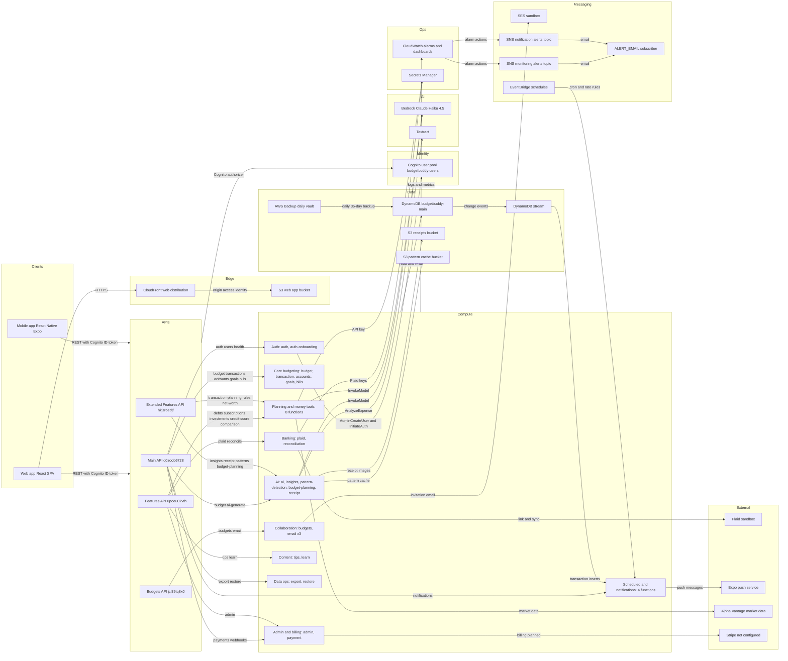

# BudgetBuddy Architecture

**Last updated**: 2026-11-01

This is the single architecture reference for BudgetBuddy. It describes the tip of `develop`, checked
against `infrastructure/bin/app.ts`, `infrastructure/lib/*.ts` and the backend code. The Wave 1
security and operations changes (auth hardening, alarm routing, data protection, the Bedrock model
switch, the deploy failure check) were deployed to dev on 2026-11-01.

## 1. Summary

BudgetBuddy is a zero-based budgeting app for web, iOS and Android. It generates a first budget with AI
from the user's location and household size, then tracks transactions against it. Users can be solo,
couples, families or roommates sharing one budget, plus read-only viewers (for example a financial
advisor) whose access can expire.

State of the system:

- Fully serverless on AWS: 10 CDK stacks, 36 Lambda functions, 4 REST APIs, one DynamoDB table.
- Dev is the only deployed environment, and it holds the real users and data.
- Web app is deployed; the mobile app is built but cannot be submitted to the App Store until the Expo
  SDK upgrade lands (it pins Expo `~49.0.15`, React Native `0.72.10`).
- Plaid runs in sandbox, SES in sandbox, Stripe is not configured, and every feature is free today.
- Main gaps: storage-key drift between modules, no MFA, no edge protection (WAF, throttling), and
  long-lived CI keys. See [Known inconsistencies](#known-inconsistencies) and
  [Security controls and known gaps](#11-security-controls-and-known-gaps).

## 2. System context

| Component | What it is | Status |
|---|---|---|
| Web app | React 18 + Vite SPA in S3 bucket `budgetbuddy-dev-web-app`, served by CloudFront `d1ueeugn9zcx7n.cloudfront.net` | Deployed |
| Admin dashboard hosting | Second S3 bucket `budgetbuddy-dev-admin-dashboard` and CloudFront distribution in the hosting stack | Deployed |
| Mobile app | React Native + Expo (`packages/mobile`), calls the same APIs | Built, not in stores |
| Main API | `q0zoob6728.execute-api.us-east-1.amazonaws.com`, stage `v1` | Deployed |
| Budgets API | `jcl39tq8x0.execute-api.us-east-1.amazonaws.com`, stage `v1` | Deployed |
| Features API | `0poeu07vth.execute-api.us-east-1.amazonaws.com`, stage `v1` | Deployed |
| Extended Features API | `hkjzroedjf.execute-api.us-east-1.amazonaws.com`, stage `v1` | Deployed |
| Cognito | User pool `budgetbuddy-users`, app client `budgetbuddy-client` | Deployed |
| Lambda | 36 functions, Node.js 20, grouped into 10 domains (section 3) | Deployed |
| DynamoDB | Single table `budgetbuddy-main` with stream and 4 GSIs | Deployed |
| S3 (data) | Receipts bucket and pattern-cache bucket, both with 30-day expiry | Deployed |
| Bedrock | Claude Haiku 4.5 through the `us.` inference profile | Deployed |
| Textract | Receipt scanning (`AnalyzeExpense`, `DetectDocumentText`) | Deployed |
| SES | Invitation and notification email, sandbox mode | Sandbox |
| EventBridge | 3 schedules driving the notification functions | Deployed |
| SNS | Monitoring and notification alert topics, each with a confirmed `ALERT_EMAIL` subscription | Deployed |
| Secrets Manager | Plaid, Stripe and Alpha Vantage keys, read at runtime | Deployed |
| AWS Backup | Daily plan, 35-day retention, vault `budgetbuddy-<env>-vault` | Deployed |
| Plaid | Bank linking, `PLAID_ENV: 'sandbox'`, no webhook route | Sandbox |
| Expo push service | Push delivery from the notifications function | Deployed |
| Alpha Vantage | Market data for investments | Deployed |
| Stripe | `payment` function answers only `/payments/health` | Not configured |

Each API serves a fixed set of route prefixes. The prefix-to-gateway table, and the rule for choosing a
gateway for a new feature, is in [API Gateway Routing Map](./gateway-routing-map.md). The four APIs exist
to keep each stack under CloudFormation's 500-resource limit (`app.ts` comments on the features and
extended stacks), not as domain boundaries, so clients must pick the right base URL per call.

## 3. Architecture diagram

A draw.io version of this diagram, with the same nodes and edges, is at
[diagrams/budgetbuddy-architecture.drawio](./diagrams/budgetbuddy-architecture.drawio).

Compute domains and their members (function names omit the `budgetbuddy-` prefix):

| Domain | Functions | Fronted by |
|---|---|---|
| Auth | `auth`, `auth-onboarding` | Main API (`auth-onboarding` comes from its own stack) |
| Core budgeting | `budget`, `transaction`, `accounts`, `goals`, `bills` | Main API |
| AI | `ai` (Main API); `insights`, `pattern-detection`, `budget-planning`, `receipt` (Extended) | Main and Extended APIs |
| Collaboration | `budgets`, `email-budgets` (Budgets API); `email` (Main API, health only); `email-features` (Features API) | Budgets API |
| Banking | `plaid`, `reconciliation` | Features API |
| Planning and money tools | `transaction-planning`, `rules`, `net-worth` (Extended); `debt-payoff`, `subscriptions`, `investments`, `credit-score`, `comparison` (Features) | Extended and Features APIs |
| Content | `tips`, `learn` | Features API |
| Data ops | `export`, `restore` | Main API |
| Admin and billing | `admin` (Features API), `payment` (Main API) | Features and Main APIs |
| Scheduled and notifications | `<env>-notifications`, `<env>-budget-alerts`, `<env>-daily-reminders`, `<env>-bill-scheduler` | Main API `/notifications` routes, DynamoDB stream, EventBridge |

Not deployed (code exists, nothing in `app.ts` instantiates it): `infrastructure/lib/admin-stack.ts`,
`infrastructure/lib/auth-register-stack.ts`, and the function directories `auth-register`, `config`,
`investments-price-updater` and `scheduled-backup`.

## 4. Request lifecycle

Every Lambda that touches budget data runs the same sequence:

1. The client sends the Cognito **ID token** in the `Authorization` header.
2. The API Gateway Cognito authorizer validates it; public routes (`/auth/login`, `/auth/register`,
   invitation preview and accept, health checks) skip it.
3. The Lambda calls `getUserFromEvent(event)`, which returns `claims["custom:userId"] || claims.sub`
   (`backend/layers/common/nodejs/utils.js:171`).
4. `BudgetAccessResolver.resolveAccess(userId, dynamoHelpers)` makes three sequential reads
   (`utils.js:484-541`): `USER#<userId>/PROFILE` (for `defaultBudgetId` and `subscriptionTier`), then
   `BUDGET#<budgetId>/MEMBER#<userId>` (rejects `revoked`, `left` and expired viewers), then
   `BUDGET#<budgetId>/METADATA` (rejects deleted budgets).
5. `assertPermission(role, action, budgetStatus)` checks a closed matrix of 16 actions and rejects
   unknown ones; archived budgets are read-only (`utils.js:565-616`).
6. `canUseFeature(subscriptionTier, featureKey)` gates features (`entitlements.js`); never compare the
   tier string directly.
7. The handler reads and writes items under `BUDGET#<budgetId>`.

The budget comes from `PROFILE.defaultBudgetId` unless the caller passes one. `PUT /budgets/active`
changes that default, so switching budgets on one device switches it for every session of that user.

## 5. Data model

Table `budgetbuddy-main` (`infrastructure/lib/database-stack.ts`): `PK`/`SK` strings, on-demand billing,
stream `NEW_AND_OLD_IMAGES`, AWS-managed encryption, point-in-time recovery always on. Deletion protection
and `RETAIN` apply unless the stack is deployed with `--context dataProtection=false`
(`infrastructure/lib/config/data-protection.ts`); both, and the AWS Backup plan, are deployed.

Key layout as the code writes it:

| Entity | PK | SK | Writer (example) |
|---|---|---|---|
| User profile | `USER#<userId>` | `PROFILE` | `auth/index.js:299-301` |
| Budget metadata | `BUDGET#<budgetId>` | `METADATA` | `auth-onboarding/index.js:146` |
| Budget member | `BUDGET#<budgetId>` | `MEMBER#<userId>` (GSI1PK `USER#<userId>`) | `budgets/index.js:371-372` |
| Budget period | `BUDGET#<budgetId>` | `PERIOD#<YYYY-MM>` | `budget/index.js:299` |
| Account | `BUDGET#<budgetId>` | `ACCOUNT#<accountId>` | `auth-onboarding/index.js:265-266` |
| Transaction | `BUDGET#<budgetId>` | `TRANSACTION#<transactionId>` (GSI1 `BUDGET#<id>` / `DATE#<date>`) | `transactions/index.js:445-448` |
| Planned transaction | `BUDGET#<budgetId>` | `PLAN#<planId>`, `entityType: 'PLANNED_TRANSACTION'` | `transaction-planning/index.js:128-130` |
| Goal | `BUDGET#<budgetId>` | `GOAL#<goalId>` | `goals/index.js:258` |
| Bill | `BUDGET#<budgetId>` | `BILL#<billId>` (GSI1PK `BILLS#<YYYY-MM>`) | `bills/index.js:282-283` |
| Invitation | `INVITATION#<invitationId>` | `METADATA` (GSI4 `INVITATION#<email>` / `CREATED#<timestamp>`, 7-day expiry) | `budgets/index.js:483-486` |
| Plaid account | `BUDGET#<budgetId>` | `PLAID_ACCOUNT#<accountId>` | `plaid/index.js:300-301` |
| Pending bank transaction | `BUDGET#<budgetId>` | `PENDING_TRANSACTION#<pendingId>` | `plaid/index.js:708-709` |
| Budget alert dedup | `BUDGET#<budgetId>` | `ALERT#<alertKey>` | `budget-alerts/index.js:78` |
| Device / notification | `USER#<userId>` | `DEVICE#<token>`, `NOTIFICATION#<id>` | `notifications/index.js:71,166` |

Other entity prefixes in use: `DEBT#`, `SUBSCRIPTION#`, `RULE#`, `ASSET#`, `NETWORTH_SNAPSHOT#`.

Global secondary indexes (generic `GSI{1-4}PK`/`GSI{1-4}SK`, all project `ALL`):

| GSI | What is actually written and read |
|---|---|
| GSI1 | Overloaded: memberships by user (`USER#<userId>`, queried at `budgets/index.js:249`), transactions and periods by budget (`BUDGET#<id>`), bills by month (`BILLS#<YYYY-MM>`, queried at `bills-scheduler/index.js:146`) |
| GSI2 | Written (`budget/index.js:300`, `transactions/index.js:449`), never queried |
| GSI3 | Never written |
| GSI4 | Invitations by email (`budgets/index.js:441-442`, `:485`) |

### Known inconsistencies

These are real defects in the data layer. Fix them through one key-builder module rather than one call
site at a time.

- **`TXN#` vs `TRANSACTION#`.** Transactions are written as `TRANSACTION#` by `transactions/index.js:446`,
  `plaid/index.js:904`, `bills/index.js:417` and `restore/index.js:151`. Executing a planned transaction
  writes `TXN#` instead (`transaction-planning/index.js:279`). Export, peer comparison and tips query
  `begins_with(SK, 'TXN#')` (`export/index.js:60`, `comparison/index.js:317`, `tips/index.js:623`), so
  they miss every normally created transaction. The stream filter that feeds budget alerts matches only
  `TRANSACTION#` inserts (`notification-stack.ts:155`), so executed planned transactions raise no alert.
- **Surviving `FAMILY#` keys.** The accounts Lambda passes the budget ID into a repository that writes
  `FAMILY#<budgetId>/ACCOUNT#...` (`accounts/repository.js:21-23`), while onboarding writes the default
  cash account under `BUDGET#` (`auth-onboarding/index.js:265`). `FAMILY#` is also read or written by
  `daily-reminders/index.js:67,254,601`, `pattern-detection/pattern-detection-repository.js:46,74`,
  `restore/index.js:110,150` and the undeployed `scheduled-backup/index.js:65`.
- **`PLAN#` vs `PLANNED_TXN#`.** Older docs and steering describe `PLANNED_TXN#<id>`; the code writes
  `PLAN#<planId>` (`transaction-planning/index.js:129`).
- **Unused indexes.** GSI2 is written but never queried and GSI3 is never written
  (`database-stack.ts` comments describe access patterns that no code uses).
- **Plaid access token in plaintext.** The token is stored on the `PLAID_ACCOUNT#` item
  (`plaid/index.js:308`) instead of Secrets Manager or a KMS-encrypted attribute.
- **Route and handler drift.** CDK names the planned-transaction path parameter `{plannedTransactionId}`
  (`api-features-extended-stack.ts:578`) while the handler reads `pathParameters.planId`
  (`transaction-planning/index.js:65,70`), so update and delete return 404. `POST /auth/confirm` has a
  CDK route (`api-stack.ts:502`) but no handler branch, so it falls through to the auth Lambda's
  placeholder "other POST" response and returns 200 without doing anything (`auth/index.js:1625-1628`).

## 6. Authentication

- **Pool** `budgetbuddy-users` (`infrastructure/lib/auth-stack.ts`): sign-in by email, account recovery
  `EMAIL_ONLY`, legacy custom attributes `familyId`/`familyRole` still defined but unused.
- **Self sign-up off and reduced client write attributes** (`auth-stack.ts:171`, `:269-276`): the public
  client can write only standard attributes plus `custom:country`, so a caller can no longer choose
  `custom:userId` at SignUp. Deployed and verified in dev.
- **Registration**: `POST /auth/register` on the Main API; the auth Lambda calls `AdminCreateUser` and
  `AdminSetUserPassword`, then writes profile, budget metadata and owner membership in one transaction
  (`auth/index.js:246-379`).
- **Sign-in**: `POST /auth/login`; the auth Lambda proxies `InitiateAuth` with `USER_PASSWORD_AUTH`
  (`auth/index.js:1338-1339`). The client also allows SRP (`auth-stack.ts:207-212`).
- **Reset-required users**: when an admin has forced a password reset, Cognito raises
  `PasswordResetRequiredException` and `POST /auth/login` returns 403 with error
  `PASSWORD_RESET_REQUIRED` (`auth/index.js:1404-1413`). The web login form then opens its reset-code
  step instead of reporting bad credentials. The mobile app signs in through Amplify, maps the same
  condition, and points the user to the web reset flow, because it has no reset screen.
- **Password reset (web, end to end)**: `POST /auth/forgot-password` `{ email }` makes Cognito email a
  code and always answers 200, so it does not reveal whether an account exists (`auth/index.js:1549`).
  `POST /auth/confirm-forgot-password` `{ email, code, newPassword }` calls `ConfirmForgotPassword`
  (`auth/index.js:1587`); `POST /auth/reset-password` is an alias for the same branch. All three are public
  Main API routes (`api-stack.ts:508`, `:514`, `:520`). Deployed and verified in dev on 2026-11-01.
- **Token lifetimes**: access and ID tokens 1 hour, refresh token 30 days (`auth-stack.ts:215-217`).
- **Google sign-in does not work.** The pool has no Google identity provider and no hosted domain. The
  custom `/auth/google` branch calls `InitiateAuth` with `ADMIN_NO_SRP_AUTH` (`auth/index.js:687-688`),
  which the client does not allow, and `GOOGLE_CLIENT_ID` defaults to an empty string
  (`api-stack.ts:161`). The planned replacement is a Cognito federated Google IdP with managed login and
  PKCE.
- **No MFA.** The pool has no `mfa` setting; the web and mobile 2FA screens have no backend endpoints.
- **Email verification is provisional.** Registration still sets `email_verified: "true"` and records
  `emailVerificationPending: true` on the profile (`auth/index.js:261`, `:314`), because a `false` value
  would block password reset while SES is in sandbox.

## 7. Authorization

| Role | Can do |
|---|---|
| `owner` | Everything, including removing members, archiving and deleting the budget |
| `partner` | All reads and writes, delete transactions, edit budget and categories, manage accounts, invite members, export |
| `household_member` | All reads, create and edit transactions |
| `viewer` | Reads only; membership can carry an `expiresAt` |

Budget types are `personal`, `family` and `shared`. The JWT never carries a budget ID or role; both come
from DynamoDB on every request (section 4). Entitlements live in `FEATURE_CATALOG`
(`backend/layers/common/nodejs/entitlements.js:37-47`); all 9 keys are `free` today, and unknown keys
fail closed.

## 8. Infrastructure as code

CDK v2 TypeScript; entry point `infrastructure/bin/app.ts`; stack names are `budgetbuddy-<env>-<slug>`.
`infrastructure/stack-manifest.json` is the checked list of stacks.

| Stack slug | Class file | Contents |
|---|---|---|
| `database` | `database-stack.ts` | Table `budgetbuddy-main`, 4 GSIs, stream, AWS Backup plan |
| `auth` | `auth-stack.ts` | User pool, app client, `Admins` group, auth shared layer |
| `auth-onboarding` | `auth-onboarding-stack.ts` | `auth-onboarding` function |
| `notification` | `notification-stack.ts` | 4 notification functions, stream mapping, 3 EventBridge rules, alert topic, 12 alarms, dashboard |
| `api` | `api-stack.ts` | Main API and 11 functions; also routes `/auth/onboarding` and `/notifications` to functions from other stacks |
| `api-features` | `api-features-stack.ts` | Features API and 11 functions |
| `api-features-extended` | `api-features-extended-stack.ts` | Extended API, 7 functions, receipts and pattern-cache buckets |
| `api-budgets` | `api-budgets-stack.ts` | Budgets API and 2 functions |
| `hosting` | `hosting-stack.ts` | Web and admin-dashboard buckets and CloudFront distributions |
| `monitoring` | `monitoring-stack.ts` | Dashboard `budgetbuddy-application-metrics`, alert topic, 5 alarms |

**Deploy order**: database, auth, auth-onboarding, notification, api, api-features,
api-features-extended, api-budgets, hosting, monitoring. `notification` comes before `api` because the
Main API takes `notificationFunction` as a prop. The real dependency edges (`app.ts` `addDependency`):
auth-onboarding on database; api on database, auth, auth-onboarding and notification; each of
api-features, api-features-extended and api-budgets on database and auth; notification on database;
monitoring on database, auth, all four API stacks and notification. Hosting and auth are independent.

**Layers**: each stack builds its own Common layer (`backend/layers/common`: DynamoDB helpers,
`BudgetAccessResolver`, `entitlements.js`, `generateId`, `BEDROCK_MODEL_ID`) and Shared layer
(`backend/layers/shared`: CORS, token parsing, validation, errors). Never export a layer across stacks;
the cross-stack export blocks later updates. Sharing the table, user pool and bucket references is safe.

**Naming and tagging**: resources use the `budgetbuddy-` prefix. `app.ts` tags every resource with
`Project`, `Application`, `Environment`, `ManagedBy`, `Owner`, `CostCenter` and `Purpose`; stacks add
`Component`, `Service` and a component-level `CostCenter` (`BudgetBuddy-Core`, `-Auth`, `-Operations`,
and so on). Physical names are hardcoded for most resources (32 function names, the table, the pool,
4 API names), which blocks deploying a second environment into the same account.

## 9. Environments and CI/CD

- **Dev only.** All 10 stacks run as `budgetbuddy-dev-*` in one AWS account and Region `us-east-1`. Dev
  holds the real data, which is why data protection is on by default.
- **`deploy-dev.yml`** runs on push to `develop` (markdown-only changes are ignored) and on manual
  dispatch: security check, `cdk synth`, staged `cdk deploy` (database, api-features, api, then `--all`),
  and a CloudFormation status check. A failed or rolled-back stack fails the run.
- **`deploy-prod.yml`** is manual dispatch only; no prod stacks exist.
- **`pr-check.yml`** runs on pull requests to `main` and `develop`. `deployment-security.yml` runs on
  push to `main` and only synthesizes. No workflow deploys staging.
- **Credentials**: the deploy jobs use long-lived IAM access keys stored as GitHub Actions secrets; GitHub
  OIDC roles are planned.
- Deploy only through GitHub Actions. See [Deployment Guide](./deployment-guide.md) and
  [Configuration Guide](./configuration-guide.md).

## 10. Observability

- **Topics**: `budgetbuddy-<env>-monitoring-alerts` (monitoring stack) and
  `budgetbuddy-<env>-notification-alerts` (notification stack, separate because monitoring depends on
  notification). Both subscribe the configured `ALERT_EMAIL` (a GitHub Actions secret), and each
  subscription must be confirmed once by email. Both subscriptions are confirmed.
- **Monitoring alarms** (`monitoring-stack.ts`): Main API 5XX sum above 10 per 5 minutes over 2 periods,
  Main API average latency above 5,000 ms, DynamoDB throttling above 0, AI fallback at least once in
  15 minutes, and estimated monthly charges above $200. Only the Main API is monitored; the other three
  APIs have no alarms.
- **Notification alarms** (`notification-stack.ts:278-337`): for each of the 4 functions, errors at least
  1 in 5 minutes, throttles above 1, and p99 duration above 80% of the function's own timeout.
- **AI metrics**: the AI functions emit `AiInvokeSucceeded` and `AiFallbackUsed` as embedded metrics in
  namespace `BudgetBuddy/AI`; alarm `budgetbuddy-ai-fallback-in-use` fires when a feature serves the
  deterministic fallback. Deployed; the alarm exists and was OK after the deploy.
- **Logs**: every wired function sets 7-day retention. API stages run with
  `dataTraceEnabled: false`. No X-Ray tracing and no API access logs.

## 11. Security controls and known gaps

In place:

- `dataTraceEnabled: false` on all four API stages, so request and response bodies are never logged.
- Encryption at rest: AWS-managed key on the table, S3-managed keys on the data buckets; S3 public
  access blocked on all four buckets; the data buckets enforce TLS.
- Closed RBAC matrix that rejects unknown actions; budget and role resolved server-side.
- Passwords and bearer tokens removed from the auth Lambda's logs. Log streams from before the fix
  were purged, and affected users were signed out globally and required to reset their password.
- Bedrock `InvokeModel` scoped to the inference-profile and foundation-model ARNs of one model
  (`infrastructure/lib/config/bedrock.ts`), model ID `us.anthropic.claude-haiku-4-5-20251001-v1:0`.
- Secrets read at runtime from Secrets Manager with ARNs scoped to `budgetbuddy/<service>/*`.
- Repository rule: [Data Protection](../.kiro/steering/data-protection.md); see also
  [Security Guidelines](../SECURITY.md).

Known gaps:

- No MFA; Google sign-in broken (section 6).
- The mobile app has no password-reset screen: its "Forgot Password?" link points at an unregistered
  navigation route, and reset-required users are sent to the web flow.
- `POST /auth/confirm` returns a placeholder 200 without confirming anything (section 5,
  [Known inconsistencies](#known-inconsistencies)).
- No WAF, no API stage throttling and no usage plans on any stack.
- Plaid access token stored in plaintext in DynamoDB.
- Every function gets `grantReadWriteData` on the whole table except `budget-alerts` and
  `daily-reminders`; SES send is granted on `*` for the features and budgets email functions.
- CloudFront uses the legacy origin access identity (`origins.S3Origin`) and default TLS and headers.
- Long-lived CI access keys; GuardDuty and AWS Config are not enabled.
- SES is in sandbox, so mail reaches verified addresses only. Verified sender identities are managed in
  the SES console; see [SES Email Setup](./ses-email-setup.md). The sender address comes from the
  `fromEmail` CDK context.

## 12. Current state vs target

| Area | Today | Target |
|---|---|---|
| API contract | Routes restated by hand in CDK, handlers, web, mobile and docs | One OpenAPI spec generating CDK routes, validators and a typed fetch client |
| API front door | 4 base URLs | One custom domain mapping paths to the gateways |
| Edge | No WAF or throttling, legacy OAI | WAF on CloudFront and API, origin access control, security headers |
| Identity | Proxied password auth, no MFA, broken Google path | Cognito managed login with Google IdP, PKCE, TOTP MFA, identity keyed on `sub` |
| Functions | Unbundled `Code.fromAsset`, per-stack layers | Bundled `NodejsFunction`, Powertools logging and tracing |
| Async work | AI, export and restore inline; scheduled jobs scan the table | Queues or Step Functions with dead-letter queues; EventBridge Scheduler |
| Data | Key drift, unused GSIs, plaintext Plaid token | One key builder, sparse GSIs per access pattern, KMS-encrypted tokens |
| Billing | All features free, Stripe not configured | Stripe and app-store notifications writing one subscription record |
| Accounts | Single account, dev serves as production, long-lived CI keys | Separate dev and prod accounts, GitHub OIDC roles per account |

## 13. Related documents

- [API Gateway Routing Map](./gateway-routing-map.md): route prefix to gateway
- [API Endpoints](./api-endpoints.md): request and response reference
- [Deployment Guide](./deployment-guide.md) and [Configuration Guide](./configuration-guide.md)
- [Architecture Decision Records](../ARCHITECTURE_DECISIONS.md)
- [Security Guidelines](../SECURITY.md) and [Data Protection](../.kiro/steering/data-protection.md)
